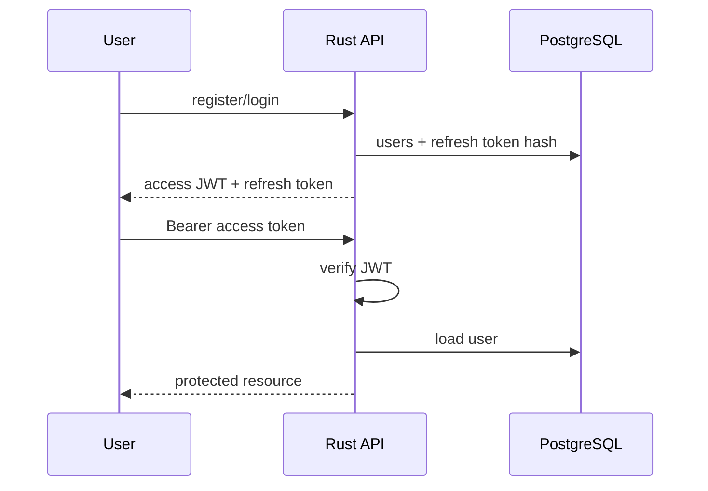

# Authentication

JWT auth provides registration, login, refresh, logout, current-user,
email-verification, password-reset, and Google OAuth endpoints. Passwords use
Argon2id; refresh and one-time tokens are stored as SHA-256 hashes.

Verification and password-reset links are logged locally when `RESEND_API_KEY`
or `EMAIL_FROM` is missing. With both configured, email is sent through Resend.
Set `REQUIRE_EMAIL_VERIFICATION=true` to block unverified logins.
Google OAuth requires `GOOGLE_CLIENT_ID` and `GOOGLE_CLIENT_SECRET`; the callback
returns a token response for API clients.

All routes are under `/api/v1/auth`. Access tokens use the `Authorization:
Bearer <token>` header. Refresh tokens are returned in the JSON response and
must be stored securely by the client.

