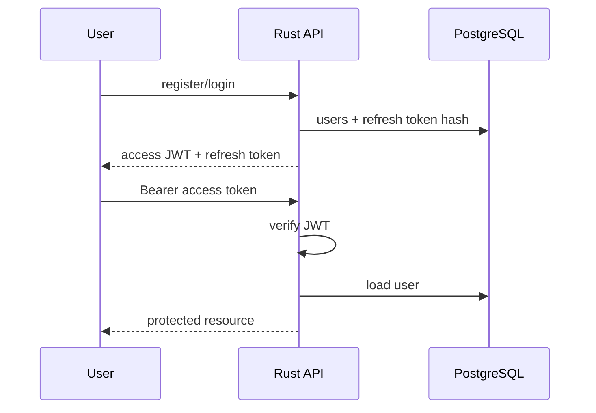

# Authentication

JWT auth provides registration, login, refresh, logout, and current-user
endpoints. Passwords use Argon2id; refresh tokens are rotated and stored as
SHA-256 hashes.

All routes are under `/api/v1/auth`. Access tokens use the `Authorization:
Bearer <token>` header. Refresh tokens are returned in the JSON response and
must be stored securely by the client.

