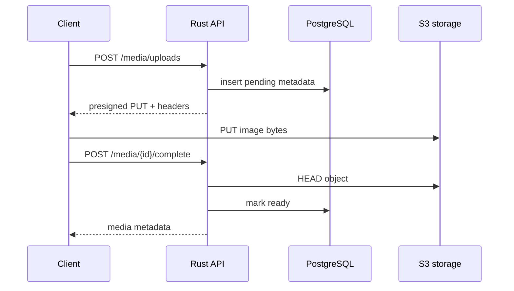

# Media

Private image uploads use S3-compatible presigned PUT/GET URLs and PostgreSQL
metadata. Uploads are reserved with `POST /api/v1/media/uploads`, completed with
`POST /api/v1/media/{id}/complete`, and read through timed URLs.

Only image content types are accepted, and objects are scoped by owner ID.
MinIO is the local provider; Cloudflare R2 uses the same S3 configuration.
Transformations are not included in the Rust provider yet.

