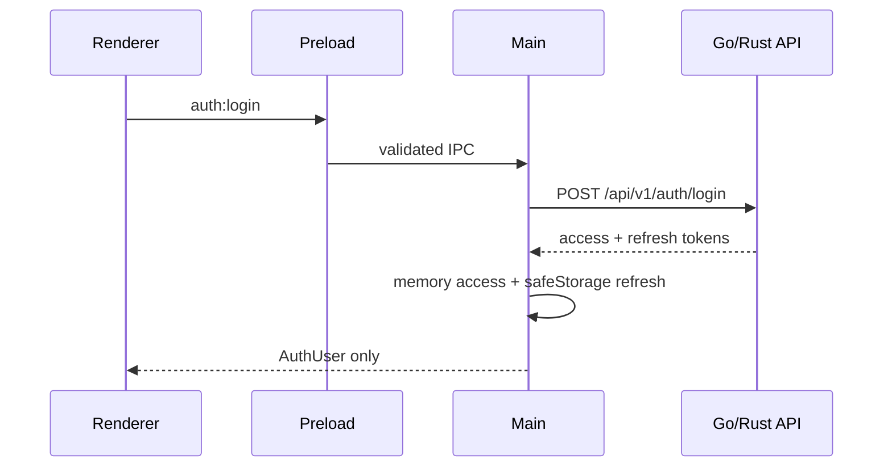

# Desktop API auth

The Electron main process owns the API session. The renderer never sees access
or refresh tokens.

- Login and register are IPC requests.
- Access tokens live in main-process memory.
- Refresh tokens are encrypted with `safeStorage`; if encryption is unavailable,
  persistence is disabled.
- `safeStorage` files are written atomically with `0600` permissions.
- Logout revokes the refresh token and clears local storage.
- API errors are mapped to the shared `Result<T>` shape.
- Offline outbox is separate; this overlay does not queue mutations.
