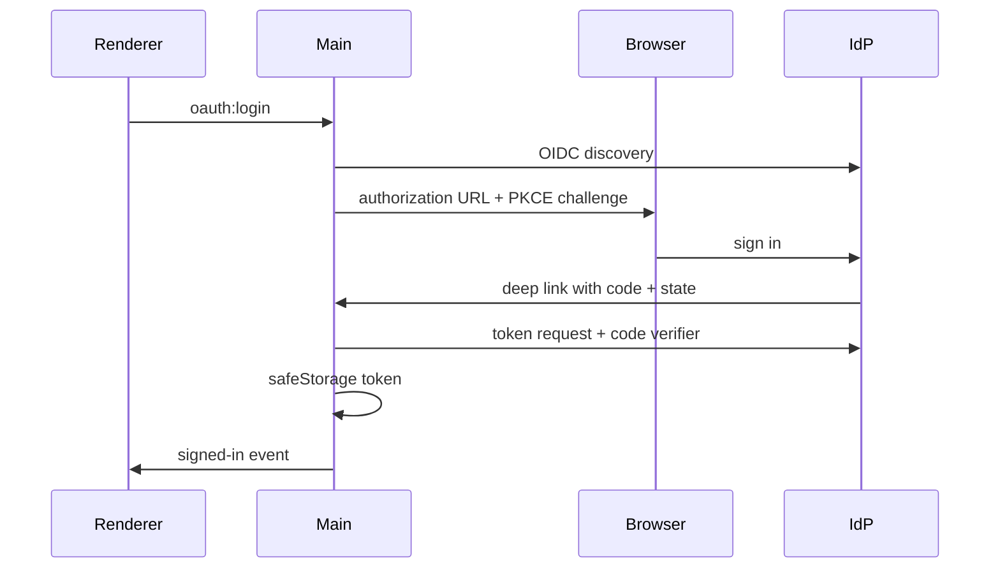

# OAuth PKCE

This optional account flow uses Authorization Code + PKCE with the system
browser and an app deep link. Tokens are encrypted with Electron `safeStorage`
in the main process and never reach the renderer.

## Configuration

```dotenv
OIDC_ISSUER=https://accounts.example.com
OIDC_CLIENT_ID=desktop-app
OIDC_REDIRECT_URI=smokeforge://auth/callback
OIDC_SCOPE=openid profile email
```

Register the redirect URI with the identity provider. Pick a custom scheme that
is unique to the product; the default is `smokeforge`.

## Flow



The main process validates state, the authorization response, and the PKCE
exchange. Invalid callbacks produce a visible error and do not store tokens.
