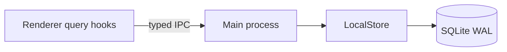

# Local SQLite storage

SQLite is the durable store for standalone desktop data. It runs only in the
main process; the renderer accesses it through validated IPC.

- `better-sqlite3` runs in the main process.
- WAL mode, foreign keys, and a 5s busy timeout are enabled.
- `PRAGMA user_version` drives migrations.
- The generic `local-data:*` IPC channels store JSON values by key.
- Do not store tokens, passwords, or secrets here; use `safeStorage`.
- Settings belong in `infra/settings.ts`; SQLite is for app data and future
  offline/outbox records.
- Native modules are rebuilt for Electron by `electron-builder install-app-deps`.

## Offline outbox

Offline editing should be a separate `offline:outbox` feature. It must add
idempotency keys, conflict policy, per-user namespacing, retry/backoff, and
logout cleanup. Do not treat SQLite as a second server database.
