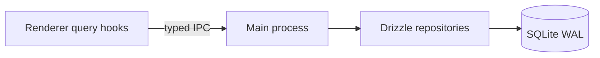

# Local SQLite storage

SQLite is the durable store for standalone desktop data. It runs only in the
main process; the renderer accesses it through validated IPC.

- `better-sqlite3` is the driver; Drizzle owns the typed schema and queries.
- Read the project-scoped `drizzle` skill before changing schema or migrations.
- WAL mode, foreign keys, and a 5s busy timeout are enabled.
- drizzle-kit generates SQL migrations in `drizzle/`; the runtime migrator
  applies them once in the main process.
- `library_items` is the relational Library table. Fullstack desktop also has
  `sync_outbox`, `sync_cursor`, and `sync_conflicts` for offline sync.
- The generic `local-data:*` channels remain available for small JSON values.
- Generated migrations must be committed and included in the packaged app.
- Settings > Data can export/import Library JSON and create a SQLite backup with
  `better-sqlite3`'s backup API.
- Settings > Advanced can enable a daily 03:00 WAL checkpoint. It is off by
  default and never touches user records.
- Do not store tokens, passwords, or secrets here; use `safeStorage`.
- Settings belong in `infra/settings.ts`; SQLite is for app data and future
  offline/outbox records.
- Native modules are rebuilt for Electron by `electron-builder install-app-deps`.

## Offline outbox

Offline editing should be a separate `offline:outbox` feature. It must add
idempotency keys, conflict policy, per-user namespacing, retry/backoff, and
logout cleanup. Do not treat SQLite as a second server database.
