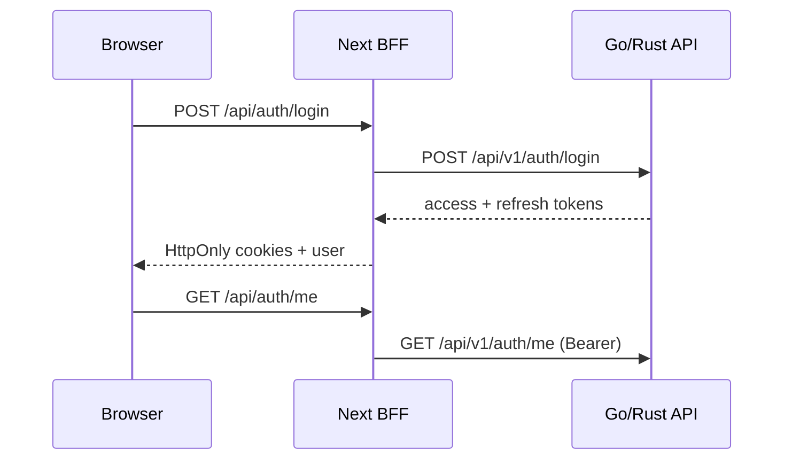

# Fullstack auth BFF

The API owns JWT issuance and refresh rotation. Next.js exposes a same-origin
BFF so browser code never handles raw tokens.

| Route | Purpose |
| --- | --- |
| `POST /api/auth/register` | Register, normalize Go/Rust response shapes, create session |
| `POST /api/auth/login` | Password login and cookie session |
| `POST /api/auth/refresh` | Rotate the refresh token |
| `POST /api/auth/logout` | Revoke the refresh session and clear cookies |
| `GET /api/auth/me` | Return the current user, refreshing once on 401 |

Cookies are `HttpOnly`, `SameSite=Lax`, `Secure` in production, and have no
JavaScript access. POST routes reject cross-origin browser requests when an
`Origin` header is present. `API_URL` is server-only and must point to the API;
never prefix it with `NEXT_PUBLIC_`.
