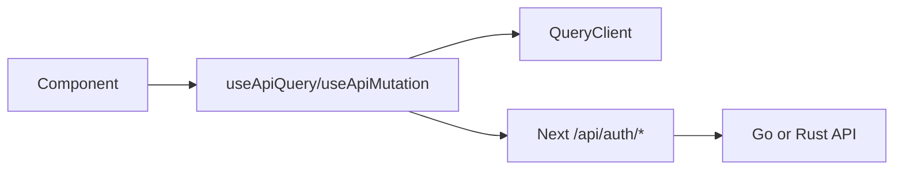

# TanStack Query

TanStack Query owns client-side server state. The app is wrapped in a
`QueryClientProvider`; use the typed hooks instead of hand-written query state.

- `useApiQuery<T>(key, path)` wraps `apiFetch` with the shared cache policy.
- `useApiMutation<TInput, TOutput>(path, method)` wraps mutations.
- `useAuthSession`, `useLogin`, `useRegister`, and `useLogout` target the
  fullstack Next BFF routes.

Keep server data in TanStack Query. Do not copy it into Zustand or local state;
use selectors and invalidation for dependent data. Query keys live in
`src/lib/query/keys.ts`.

