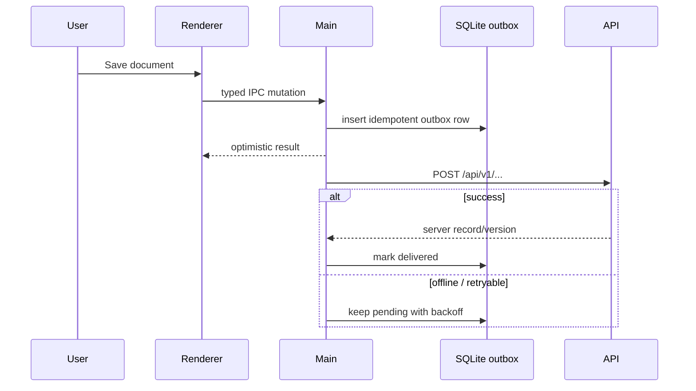
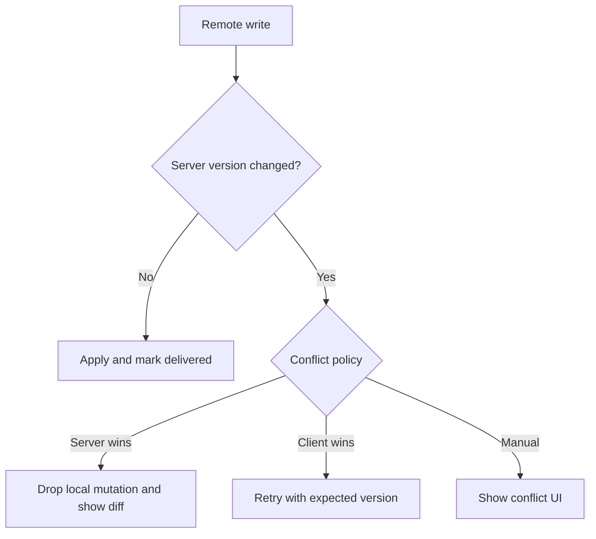

# Offline editing design

Offline write support is a separate `offline:outbox` feature. It is not enabled
by the base desktop storage overlay.

## Flow

## Required rules

- The API remains the source of truth.
- Generate stable client IDs before the first write.
- Send an `Idempotency-Key` per mutation.
- Persist ordered outbox rows with attempt count, next retry, and last error.
- Define a conflict policy before enabling writes: server-wins, client-wins, or
  field-level merge.
- Namespace local data and outbox rows by user; clear them on logout.
- Never store access or refresh tokens in SQLite.
- Keep retries bounded and surface permanent failures to the UI.
- Do not run a background sync from the renderer.

## Mermaid conflict decision

