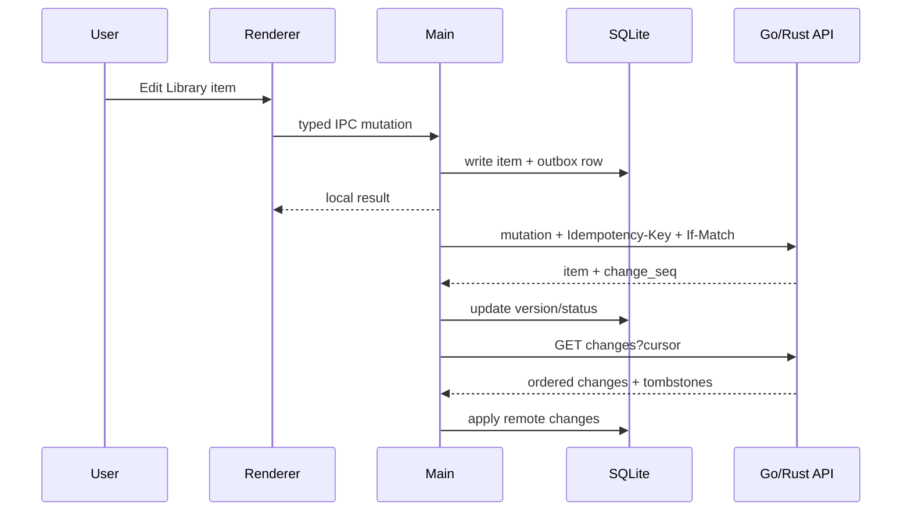

# Desktop offline sync

The fullstack Electron app is local-first. Library mutations commit to SQLite
and an outbox in the same user action, then the main process syncs with the
Go or Rust API. The renderer never calls the API directly.

## Contract

- Every API item has a stable client-generated UUID and integer `version`.
- Every mutation is versioned and idempotent.
- `library_changes` is an append-only server changefeed with tombstones.
- Clients pull changes by opaque/monotonic cursor, never by wall-clock time.
- The API filters every query by the authenticated user.

## Desktop state

`library_items` gains `version`, `sync_status`, and `owner_id`. The sync tables
are `sync_outbox`, `sync_cursor`, and `sync_conflicts`.

Every local mutation writes the item and outbox row in one local transaction.
The outbox stores the operation, payload, base version, idempotency key, retry
count, and next attempt.

## Lifecycle

1. On login or existing session restore, the main process starts sync.
2. Pull the change feed from the stored cursor.
3. Push pending outbox rows in creation order.
4. A successful response updates the local version and marks the row synced.
5. Pull again to consume changes from the same or other devices.
6. Repeat after each local mutation and every 30 seconds while pending.

## Retry rules

- Exponential backoff with jitter, capped at five minutes.
- Maximum 10 automatic attempts.
- Retry network errors, `408`, `429`, and `5xx`; honor `Retry-After`.
- Refresh once on `401`.
- Permanent `4xx` responses are surfaced as failed.
- Conflicts are never retried automatically under the default manual policy.
- Sync stops on logout.

## User and logout rules

- Outbox, cursor, and conflict rows are scoped by the authenticated user ID.
- The current desktop cache assumes one signed-in account per OS profile.
  Multi-account support must namespace or clear local records on account switch
  before it is enabled.
- Sync stops on logout.
- Never store access or refresh tokens in SQLite.

## Related documents

- [`CONFLICTS.md`](CONFLICTS.md) for conflict resolution.
- [`docs/OFFLINE.md`](docs/OFFLINE.md) for the original outbox design.
- [`apps/api/docs/LIBRARY_SYNC.md`](../apps/api/docs/LIBRARY_SYNC.md) for the API contract.
