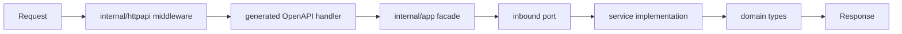

# Architecture

This project uses a hexagonal (ports and adapters) architecture. The domain is
independent of Gin, the database, and outbound clients.

## Request flow



## Packages

| Package | Responsibility |
| --- | --- |
| `cmd/api` | Reads config, builds the logger, wires adapters, starts and stops HTTP. |
| `internal/httpapi` | Primary Gin adapter, middleware, generated server interface, docs. |
| `internal/response` | Success response helpers and RFC 9457 error responses. |
| `internal/app` | Adapts inbound ports to the HTTP transport. |
| `internal/port` | Inbound application contracts. |
| `internal/service` | Application implementation of inbound ports. |
| `internal/domain` | Pure domain types and invariants. |
| `internal/config` | Typed environment configuration and validation. |
| `internal/logging` | Zap configuration. |
| `internal/server` | HTTP and pprof listeners, graceful shutdown. |
| `internal/version` | Build metadata. |

## Boundaries

- `domain` never imports Gin, SQL, or infrastructure packages.
- Ports belong where consumed; adapters implement them.
- No business logic in HTTP handlers.
- No global mutable state or `init()`.
- Context flows from the request through every call.
- Errors are returned with context and mapped to RFC 9457 at the boundary.

## Swagger and contract

`internal/swagger/openapi.yaml` is the base contract. Each documented feature
registrar contributes another OpenAPI document. At startup the server merges
them into `/openapi.json` and serves Swagger UI at `/docs`.

## Process lifecycle

`cmd/api/main.go` is the composition root. It loads configuration, builds the
logger, creates the signal-aware context, constructs database and feature
dependencies, builds the router, starts the server, and cleans up resources.
It contains no business logic, SQL, route handlers, or middleware bodies.

`internal/server/server.go` owns the process lifecycle. It binds the HTTP and
optional pprof listeners, configures server timeouts, serves the injected
`http.Handler`, and performs bounded graceful shutdown. It does not know about
Gin, auth, PostgreSQL, or feature packages.

Dependencies flow one way:

```text
main.go
  → config + logger
  → database / feature adapters
  → services and handlers
  → httpapi.New(cfg, logger, options...)
  → server.New(cfg, logger, handler)
```

Constructors receive what they need. Feature routes are injected through
`httpapi.WithRegistrar`; readiness and application dependencies use
`httpapi.WithReadiness` and `httpapi.WithPinger`. Do not create services or
handlers inside `server.go`.

## Middleware

Global middleware is wired exactly once, in `internal/httpapi/router.go` inside
`httpapi.New`. The order is:

```text
RequestID
  → RequestLogger
  → Recovery
  → SecurityHeaders
  → CORS
  → BodyLimit
  → RateLimit
  → Timeout
  → generated and feature routes
```

- `RequestID` creates a UUIDv7, stores it on the context, and sets
  `X-Request-ID`.
- `RequestLogger` emits one structured line per request with the request ID.
- `Recovery` uses `gin.CustomRecovery`, logs the panic and stack, and returns an
  RFC 9457 500 response.
- `SecurityHeaders` sets defensive browser headers; HSTS is added in production.
- `CORS` handles preflight and actual cross-origin requests before body or rate
  limiting so browser clients can read those errors.
- `BodyLimit` rejects oversized bodies.
- `RateLimit` applies a bounded per-client-IP token bucket.
- `Timeout` attaches a request deadline and returns 504 if the handler outlives
  it without writing a response.

Middleware dependencies come from injected configuration and the logger. The
middleware constructors have no package-global mutable state. Add global
middleware in `httpapi.New`; add route-specific middleware in the owning
registrar.
