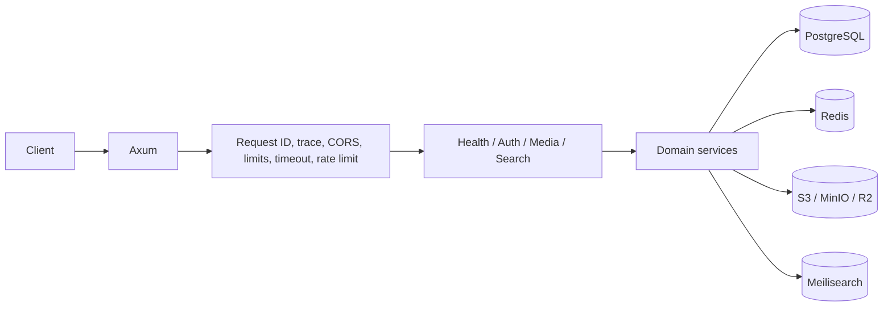

# Architecture

The API is one crate with domain-oriented modules. `main` wires configuration,
telemetry, state, and the Axum application. `lib` exposes the router for
network-free tests. Health, database, and auth concerns live in their own
modules instead of a shared technical-layer directory.

## Request flow

