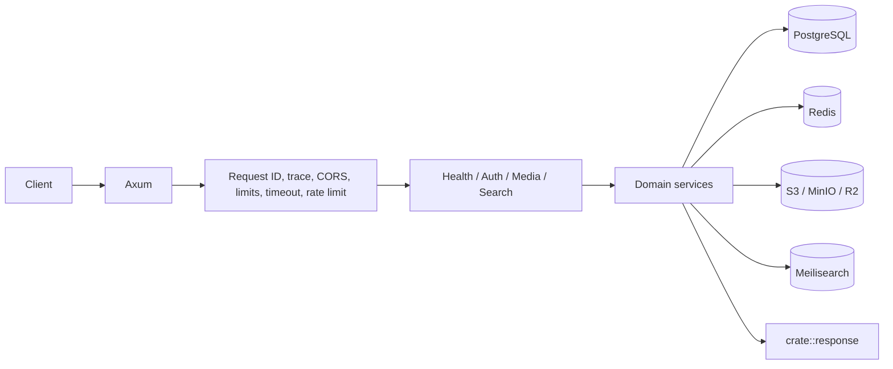
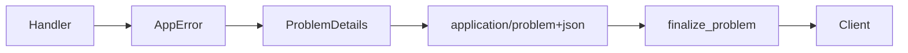

# Architecture

The API is one crate with domain-oriented modules. `main` wires configuration,
telemetry, state, and the Axum application. `lib` exposes the router for
network-free tests. Health, database, and auth concerns live in their own
modules instead of a shared technical-layer directory.

## Code map

| Path | Responsibility |
| --- | --- |
| `src/main.rs` | Loads config, starts telemetry, builds state/router, serves, and shuts down. |
| `src/lib.rs` | Public crate composition: router, middleware order, OpenAPI, and test entrypoint. |
| `src/config.rs` | The only environment reader; typed values are validated before binding. |
| `src/error.rs` | `AppError`, stable error codes, and the `IntoResponse` boundary. |
| `src/response.rs` | Success helpers, RFC 9457 `ProblemDetails`, field errors, and response finalization. |
| `src/state.rs` | Cheaply cloneable `AppState` and the readiness trait. |
| `src/telemetry.rs` | Tracing subscriber and structured logging setup. |
| `src/health/` | Liveness and readiness routes. |
| `tests/` | HTTP integration tests and shared test helpers. |

Feature overlays add a self-contained module under the relevant domain:
`db/`, `auth/`, `cache/`, `queue/`, `media/`, `search/`, or `scheduler/`. Do not add generic
`handlers/`, `services/`, or `models/` directories.

## Request flow

## Error response flow

The base middleware stack ends in `response::finalize_problem`. It reads the
request path and `X-Request-ID` and injects `instance` and `request_id` without
each handler repeating that logic. Problem bodies are bounded before JSON
parsing; malformed or oversized problem bodies are returned unchanged.

## Extension points

| Change | Where |
| --- | --- |
| New endpoint | Domain route module under `src/<domain>/routes.rs`; merge it in `main.rs` or the feature router. |
| New error kind | Add a constructor in `src/error.rs`; return `AppError` from the service/route boundary. |
| New success response | Use `crate::response::{ok, created, accepted, json, no_content}`. |
| New response extension | Add it to `ProblemDetails` and cover it in `src/response.rs` tests. |
| Middleware | Add it in `lib.rs` `app()` and preserve request-ID/finalizer ordering. |
| OpenAPI | Add a `#[utoipa::path]` schema and include it in the domain `document()` or base `ApiDoc`. |
| Environment setting | Add it to `src/config.rs`, `.env.example`, and the validation tests. |

## Boundaries

- Handlers stay thin; application logic belongs in services, infrastructure
  behind consumer-owned interfaces.
- No `unwrap`/`expect` in production request paths.
- Never hold locks across `.await`; use `tokio` primitives and bounded work.
- Keep `AppState` cheap to clone.
- Parameterized SQL only.
- Error details are safe for clients; never include secrets, SQL, or internal
  paths in `detail`.
- Return RFC 9457 `application/problem+json`; never hand-build error JSON.
