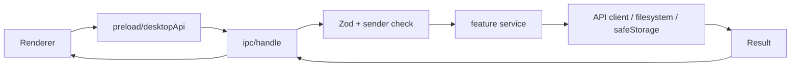

# Architecture

The app has three process boundaries:

| Process | Trust | Responsibility |
| --- | --- | --- |
| Main | Trusted | lifecycle, windows, IPC validation, secrets, API, filesystem |
| Preload | Narrow bridge | exposes typed functions through `contextBridge` |
| Renderer | Untrusted | React UI, DOM, local state, TanStack Query cache |

## Request flow

## Startup

1. Register the privileged `app://` scheme.
2. Acquire the single-instance lock.
3. Wait for `app.whenReady()`.
4. Register the `app://` handler, session security, and IPC handlers.
5. Create the main window.
6. In development, load `ELECTRON_RENDERER_URL`; in production, load
   `app://bundle/index.html`.

## Extension points

| Change | Location |
| --- | --- |
| New window | `src/main/windows/` + a factory |
| New IPC feature | `src/main/features/<feature>/` and `src/shared/ipc/<feature>.ts` |
| New renderer route | `src/renderer/src/app/router.tsx` + a feature page |
| Renderer colors | `src/renderer/src/styles/globals.css`; native chrome in `src/shared/design-tokens.ts` |
| New shell command | `src/shared/commands.ts` + native menu and renderer palette |
| New renderer feature | `src/renderer/src/features/<feature>/` |
| Typed preferences | `src/main/infra/settings.ts` |
| Durable local data | `src/main/storage/` (Drizzle, migrations, outbox) |
| Offline sync | `src/main/features/sync/` + `storage/sync-bridge.ts` |
| New system adapter | `src/main/infra/` |
| New heavy job | `src/main/workers/` through `utilityProcess` |
| Native window | `src/main/windows/` |
| Update behavior | `src/main/features/updates/` |
| CSP/permissions | `src/shared/csp.ts` (policy), `src/main/security/` (session) |
| Packaging | `electron-builder.yml`, `scripts/after-pack.cjs` |

Services should not import `electron` unless they genuinely need a main-process
primitive. Prefer injected values so tests can run without Electron.
