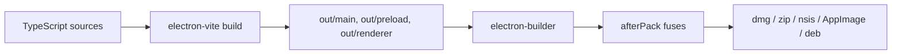

# Packaging

```bash
make package-dir
make package
```

electron-builder produces:

- macOS: `dmg` and `zip`
- Windows: `nsis`
- Linux: `AppImage` and `deb`

The packaged app is built from `out/` and uses the custom `app://bundle` origin.
The `afterPack` hook applies Electron fuses. It requires `@electron/fuses` at
build time.

## Build pipeline



## Signing

- macOS: Developer ID certificate + notarization credentials in CI secrets
- Windows: Authenticode/EV certificate in CI secrets
- Linux: package signing policy is project-specific

Do not commit signing certificates. The default config intentionally contains
no credentials.
