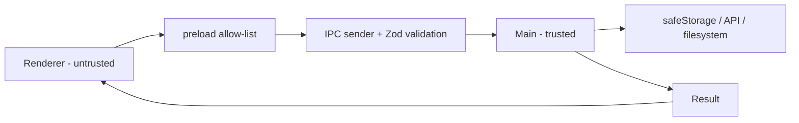

# Security

## Required defaults

- `contextIsolation: true`
- `sandbox: true`
- `nodeIntegration: false`
- `webSecurity: true`
- `webviewTag: false`
- no raw `ipcRenderer` exposure
- no remote module
- no arbitrary navigation or new windows
- renderer trust uses exact origins (`src/shared/security.ts`), never string
  prefixes; `ELECTRON_RENDERER_URL` is honored only in unpackaged development
  builds and only for loopback dev servers (`src/main/infra/dev-server.ts`)
- CSP delivered by the session, not only the HTML meta tag
- one CSP source of truth in `src/shared/csp.ts`; only development (`make dev`)
  adds `'unsafe-inline'` scripts and localhost `connect-src` for React Fast
  Refresh and the Vite HMR socket (see [DEVELOPMENT.md](DEVELOPMENT.md))

## Trust boundary

## IPC

- Every handler validates its payload with Zod.
- The handler checks the sender window and frame origin.
- The renderer gets only a `Result<T>` value, never a raw Error.
- The preload script is passthrough only; business logic belongs in main.

## Tokens

- Access tokens stay in main-process memory.
- Refresh tokens are encrypted with Electron `safeStorage`.
- If encryption is unavailable, do not persist refresh tokens.
- Never log a token, password, recovery code, or secret.
- Never send a token to the renderer.

## Navigation and external links

The app allows navigation only to the configured dev origin or `app://bundle`.
External links must be explicitly allow-listed and opened through
`shell.openExternal`; do not pass arbitrary URLs through.

## Packaging

- ASAR enabled.
- Electron fuses configured in `scripts/after-pack.cjs`.
- Code signing and notarization credentials come from CI secrets.
- Do not commit certificates, passwords, or API keys.
