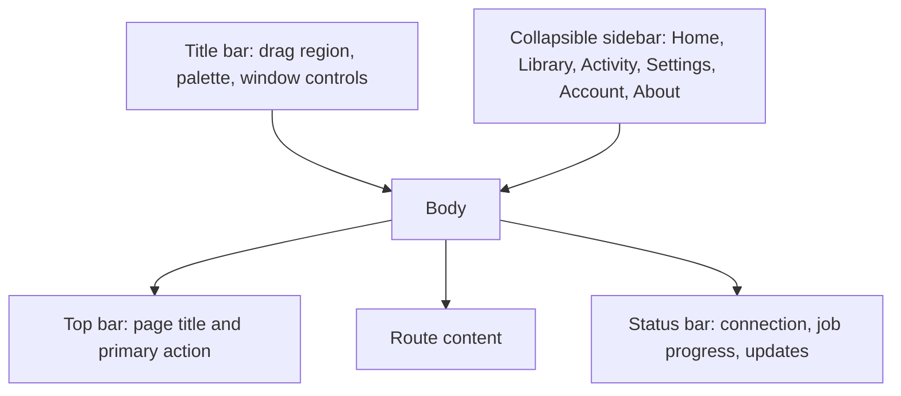

# UI shell

The renderer is a hash-routed React application. The shell owns navigation and
cross-cutting behavior; feature pages own their data and interactions.

## Routes

| Route | Purpose |
| --- | --- |
| `/` | Dashboard with stats, chart, and recent records |
| `/library` | Library list, search, filters, inspector |
| `/library/:itemId` | Selected Library record |
| `/activity` | Utility-process job progress, cancel, retry |
| `/settings` | Theme, language, data, updates, diagnostics |
| `/account` | Auth/account boundary |
| `/about` | Runtime information and support bundle |

## Visual system

The desktop uses the shared web palette: cream paper, charcoal ink, tide teal,
and a rare coral signal. The renderer palette has one source of truth in
`src/renderer/src/styles/globals.css`; native window chrome uses
`src/shared/design-tokens.ts`. `DESIGN.md` holds the rationale and usage rules.

## Shell behavior

- `Cmd/Ctrl+K` opens the command palette.
- `Cmd/Ctrl+B` collapses the sidebar.
- Dashboard stat cards can be reordered with drag and drop or the keyboard; the
  order is stored as `dashboardOrder` in non-sensitive settings.
- `Cmd/Ctrl+1/2/3` navigates Home, Library, and Activity.
- The native menu emits the same command IDs as the renderer keyboard registry.
- Theme follows `nativeTheme`; light, dark, and system are persisted.
- The title bar uses a CSS drag region and keeps every control in a no-drag
  region. macOS uses inset traffic lights; Windows and Linux use the native
  title bar overlay.
- Route errors render a recovery boundary instead of a blank window.
- Offline status is shown in the status bar; queries use TanStack Query retry.
- Settings, About, Activity, Library, and shell chrome use i18next keys.

## Library screen

The Library uses a resizable list/detail layout:

1. Search, status filter, and sort controls.
2. TanStack Table column definitions with TanStack Virtual row rendering.
3. A typed IPC repository backed by Drizzle.
4. React Hook Form + Zod editor in the inspector.
5. Delete is soft, with an undo toast.
6. A dropped JSON export or the import action adds records; duplicate titles are
   skipped.
7. A detached window can open one record without duplicating state ownership.
8. Fullstack-mode rows show local, pending, synced, failed, or conflicted state.
   Conflict rows open a manual inspector panel with Keep local and Use server.
