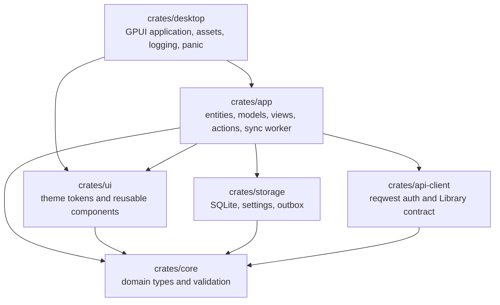
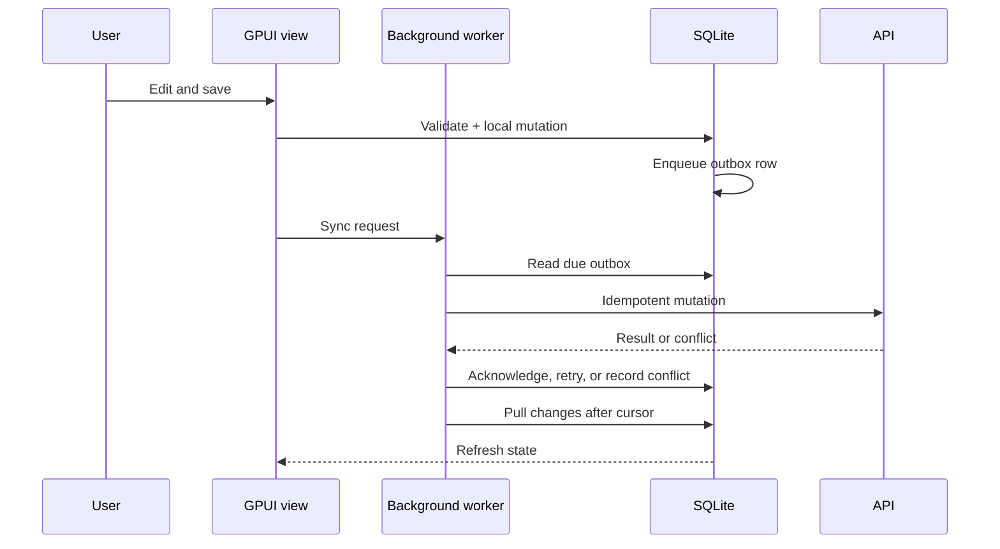

# Architecture

Dependencies point down. GPUI may appear only in `ui`, `app`, and `desktop`.

## Code layout

| Path | Responsibility |
| --- | --- |
| `crates/desktop` | Process entry point, assets, logging, panic handling |
| `crates/app/src/lib.rs` | `AppView` state, actions, initialization, pane routing |
| `crates/app/src/shell.rs` | Window chrome: title bar, sidebar, command palette, status bar |
| `crates/app/src/pages` | One feature module per page: dashboard, library, activity, settings, account, about |
| `crates/app/src/sync.rs` | Background sync worker and queue processing |
| `crates/ui/src/components` | Reusable presentation primitives: page headers, section cards, stat cards, empty states |
| `crates/core` | Domain types, validation, and shared contracts |
| `crates/storage` | SQLite, settings, credentials, and outbox persistence |
| `crates/api-client` | HTTP client and API contracts |

`shell.rs` composes the application frame and selects the active pane. Page
modules extend `AppView` with feature-specific render methods. `crates/ui`
contains presentation only: it must not own application state, persistence, or
network access.

## Change guide

- Add a page under `crates/app/src/pages`, register it in `pages/mod.rs`, then
  add its `Pane` variant, action, label, and locale keys.
- Keep `crates/app/src/lib.rs` focused on state, actions, and initialization.
  Keep `shell.rs` focused on chrome and routing.
- Put repeated project-specific visuals in `crates/ui/src/components` and use
  semantic theme tokens. Use GPUI Kit components directly for standard controls.
- Keep page files small enough to read in one pass; split repeated sections into
  child components rather than adding another mode to a large render method.

## Runtime

