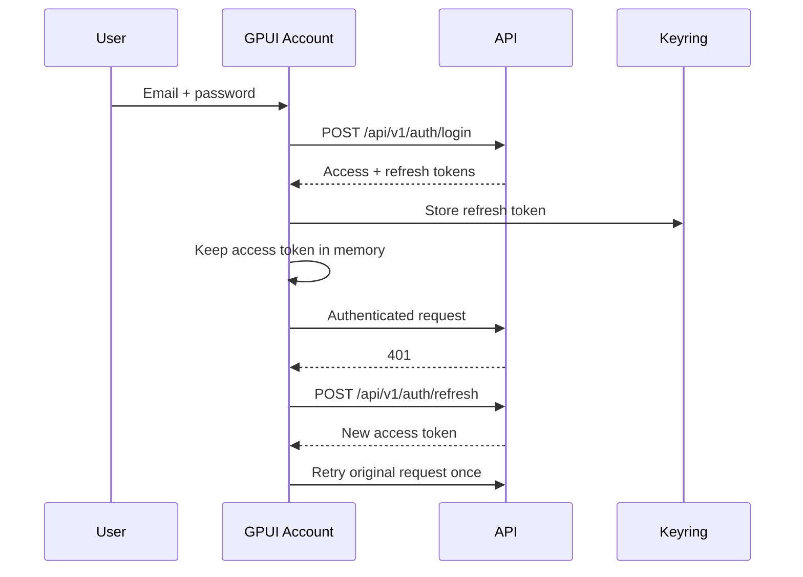

# Authentication

The desktop app supports a local-only mode and an API-backed mode.

## Local-only

No network client is used and the Account pane is hidden. The Library is stored
in per-user SQLite and never leaves the machine.

## API-backed

Set `SMOKEFORGE_API_MODE=api` and `SMOKEFORGE_API_URL` before launch. The Account
pane appears; sign-in uses `/api/v1/auth/login`.

- The refresh token is written through `TokenStore` to the OS keyring.
- The access token stays in process memory only.
- If the keyring is unavailable, the token store degrades to memory and shows a
  warning in Settings.
- Tokens must never be written to settings JSON, SQLite, logs, or diagnostics.
- API calls retry once after a 401 by refreshing the access token.

