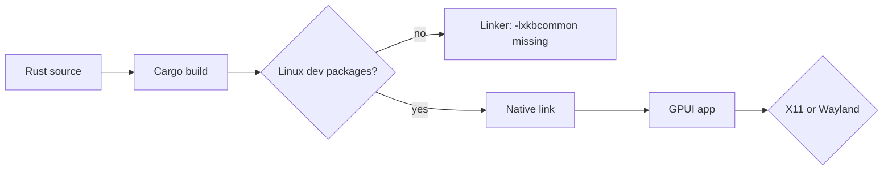

# Build prerequisites

## Linux

Install the native development packages before building or testing. The runtime
libraries are not enough: GPUI links against the unversioned development
symlinks.

### Debian / Ubuntu

```bash
sudo apt-get update
sudo apt-get install -y \
  build-essential pkg-config \
  libfontconfig1-dev libfreetype6-dev \
  libxkbcommon-dev libxkbcommon-x11-dev \
  libwayland-dev libx11-xcb-dev libxcb1-dev
```

### Fedora

```bash
sudo dnf install -y \
  gcc gcc-c++ make pkgconf-pkg-config \
  fontconfig-devel freetype-devel \
  libxkbcommon-devel libxkbcommon-x11-devel \
  wayland-devel libxcb-devel
```

### Arch

```bash
sudo pacman -S --needed base-devel pkgconf \
  fontconfig freetype2 libxkbcommon libxkbcommon-x11 \
  wayland libxcb
```

Run `make doctor` from the generated project to check the native packages.

### The common linker error

```text
rust-lld: error: unable to find library -lxkbcommon
rust-lld: error: unable to find library -lxkbcommon-x11
```

This means the runtime libraries exist but the `-dev`/`-devel` packages are
missing. Install `libxkbcommon-dev libxkbcommon-x11-dev` (Debian/Ubuntu),
`libxkbcommon-devel libxkbcommon-x11-devel` (Fedora), or the equivalent.



The generated `.cargo/config.toml` enables fontconfig `dlopen` for machines that
have the fontconfig runtime library but not the development package. It does
not replace the XKB development packages required by the linker.

## macOS

Install the Xcode command-line tools and Rust. GPUI uses the native macOS
windowing and text stacks.

## Windows

Install the MSVC build tools and Rust. Use the
`stable-x86_64-pc-windows-msvc` toolchain.

## CI

CI installs the Linux development packages before `cargo check`, `cargo test`,
and packaging.
