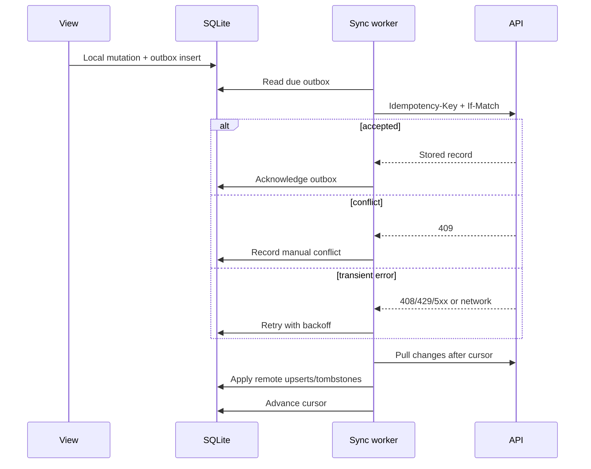

# Sync

The desktop app is local-first. Every Library mutation is persisted locally and
added to the durable outbox. Sync runs in a background worker and never blocks
the GPUI render loop.

Rules:

- Local mutation and outbox insertion should remain one transaction.
- Pending local outbox rows are never overwritten by a pull.
- Conflicts are never silently resolved; the user chooses Keep local or Use
  server.
- Signing out stops sync and clears the in-memory access token.
- The GPUI view must not call the API or write the outbox directly.

The standalone preset is local-only. Fullstack API mode enables the sync path.
