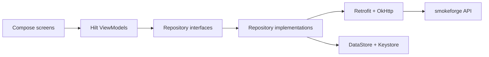

# Architecture

## Runtime

## Module responsibilities

| Module | Responsibility |
| --- | --- |
| `:app` | Application, activity, session gate, root navigation |
| `:core:common` | Result, error, dispatcher contracts |
| `:core:model` | Domain models and repository interfaces |
| `:core:designsystem` | Material 3 theme and shared components |
| `:core:network` | API interfaces, DTOs, RFC 9457 mapping |
| `:core:datastore` | Preferences, encrypted token storage |
| `:core:data` | Repository implementations, session, Hilt modules |
| `:core:testing` | Fakes and test data |
| `:feature:auth` | Auth UI and state |
| `:feature:home` | Home UI and state |
| `:feature:settings` | Settings UI and state |

## Data flow

1. A composable receives a `UiState` and emits callbacks.
2. The ViewModel updates state and calls a repository interface.
3. The repository implementation coordinates network, storage, and session policy.
4. Tokens are held by `SessionManager` and encrypted before persistence.
5. API failures become typed `AppError` values and are mapped to UI copy at the
   presentation boundary.

## Conventions

- One screen has one immutable `UiState`.
- Events flow upward, state flows downward.
- Features never import another feature.
- Cross-feature navigation belongs to `:app`.
- Hilt bindings live in `:core:data` and `:core:datastore`; features only inject
  interfaces.
- Build settings are centralized in `build-logic`.
- `build-logic` and the version catalog are the source of truth for toolchain
  conventions.
