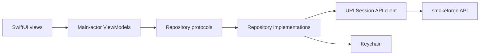

# Architecture

## Runtime

## Packages

| Package | Responsibility |
| --- | --- |
| Core | Models, errors, repository protocols, theme preference |
| Networking | URLSession client, DTOs, problem details |
| Storage | Keychain token store |
| Data | Repositories and session policy |
| DesignSystem | Smoke theme and shared components |
| TestSupport | Fakes and fixtures |
| AuthFeature | Sign in, registration, password reset |
| HomeFeature | API status and account |
| SettingsFeature | Appearance and sign-out |

## Dependency direction

- `App` depends on features, Data, and DesignSystem.
- Features depend on Core and DesignSystem.
- Data depends on Networking, Storage, and Core.
- Networking and Storage depend on Core.
- Core does not import SwiftUI or UIKit.

## State and navigation

- SessionStore is main-actor observable and owns the signed-in state.
- RootView observes the session and switches between auth and the main shell.
- The app target owns the tab coordinator; feature-local navigation uses
  `NavigationStack`.
- ViewModels expose state and async actions; views never call networking or
  Keychain directly.

## Build

- `project.yml` is the XcodeGen source of truth.
- Debug, Staging, and Release read separate xcconfig files.
- `make project` generates the project; `.xcodeproj` is not committed.
