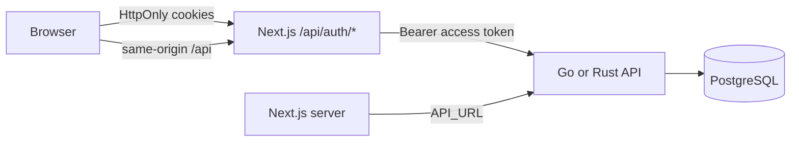

# Context map

This workspace can have up to four context boundaries. Read the closest `CONTEXT.md`
before changing code in that area.

| Area | Context | Responsibility |
| --- | --- | --- |
| API | [`apps/api/CONTEXT.md`](apps/api/CONTEXT.md) | HTTP contracts, auth, data access, background work |
| Web | [`apps/web/CONTEXT.md`](apps/web/CONTEXT.md) | Server Components, BFF route handlers, client state |
| Workspace | [`CONTEXT.md`](CONTEXT.md) | Cross-app wiring, environment, Docker, CI |

## Runtime flow

## Code layout

- API layout: [`apps/api/README.md`](apps/api/README.md) and
  [`apps/api/docs/ARCHITECTURE.md`](apps/api/docs/ARCHITECTURE.md).
- Web layout: [`apps/web/README.md`](apps/web/README.md).
- Workspace layout: [`README.md`](README.md).

## Boundaries

- The API owns JWT issuance, refresh rotation, authorization, and persistence.
- The web app owns presentation and the BFF. It must not implement a second
  authoritative auth database for fullstack projects.
- Only the BFF sees raw access and refresh tokens. Browser code uses
  `useAuthSession`, `useLogin`, `useRegister`, and `useLogout` from
  `apps/web/src/lib/query/hooks.ts`.
- TanStack Query owns client-side server state. Zustand is only for local UI
  state.
- Cross-app changes require checking both context files and updating this map.

<!-- smokeforge:anchor desktop-context -->
