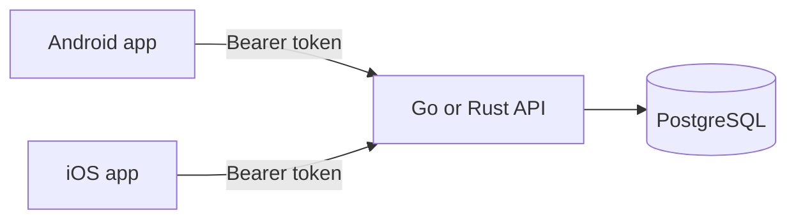

# Context map

This workspace contains an API and one or both mobile clients. Read the closest
`CONTEXT.md` before changing code in that area.

| Area | Context | Responsibility |
| --- | --- | --- |
| API | [`apps/api/CONTEXT.md`](apps/api/CONTEXT.md) | HTTP contracts, auth, data access, background work |
| Android | `apps/android/CONTEXT.md` | Compose UI, Hilt graph, Android session |
| iOS | `apps/ios/CONTEXT.md` | SwiftUI UI, package graph, iOS session |
| Workspace | [`CONTEXT.md`](CONTEXT.md) | Cross-app wiring, environment, CI |

## Runtime flow

## Boundaries

- The API owns JWT issuance, refresh rotation, authorization, and persistence.
- Each mobile app owns its native UI, local token storage, and platform lifecycle.
- Mobile apps never share database access or server secrets.
- Keep platform error models aligned with the API problem-details contract.
- Cross-app changes require checking both context files and updating this map.
